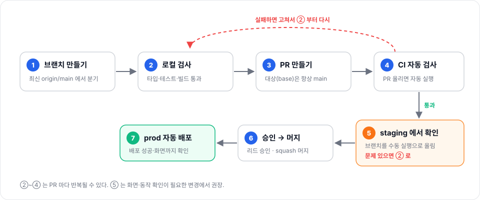
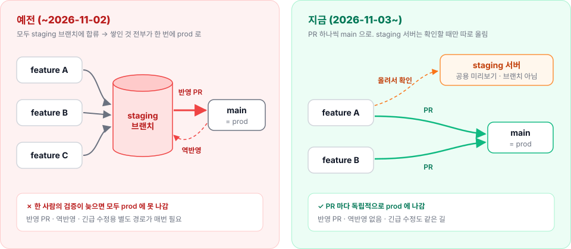

# 브랜치 전략 가이드

> **한 줄 요약 — 배포 단위는 PR 하나다.** 브랜치는 `feature/*` 와 `main` 두 가지뿐이고, `main` 에 머지하면 prod 에 자동 배포된다. staging 은 브랜치가 아니라 **아무 브랜치나 올려 보는 공용 서버**다.
>
> 2026-11-03 부터 적용 (이전의 `staging` 브랜치·반영 PR·역반영은 폐지 — [gos-harness#135](https://github.com/scaleup-squad/gos-harness/issues/135))



## 목차

- [브랜치 구조](#브랜치-구조)
- [작업 흐름](#작업-흐름)
- [staging 서버 쓰는 법](#staging-서버-쓰는-법)
- [PR 규칙](#pr-규칙)
- [긴급 수정·되돌리기](#긴급-수정되돌리기)
- [예전 방식과 무엇이 달라졌나](#예전-방식과-무엇이-달라졌나)

---

## 브랜치 구조

| 브랜치 | 역할 | 규칙 |
|---|---|---|
| `main` | prod 그 자체 | 직접 push 금지 · PR + 승인 1명 + CI 통과 필수 · 머지 = prod 자동 배포 |
| `feature/*` | 모든 작업 (기능·버그·긴급 수정 구분 없음) | **항상 최신 `origin/main` 에서 분기** · 머지 후 삭제 |

- `develop`·`staging`·`release/*` 브랜치는 **없다**. 만들지 않는다.
- 이름은 `feature/짧은-설명` (영문 소문자·하이픈 권장). 자동 PR 은 `auto/*`, 되돌리기는 GitHub 기본 `revert-*` 를 그대로 쓴다.
- 광고비 진단·내부 도구 레포(ad-audit·ad-engine·hermes 등)는 staging 서버가 없다 — 같은 흐름에서 3단계만 빠진다.

---

## 작업 흐름



```bash
# ① 최신 main 에서 분기
git fetch origin
git switch -c feature/quote-page origin/main

# ② 작업 → 로컬 검사 → 커밋
# ③ PR 생성 (대상은 항상 main)
git push -u origin feature/quote-page
gh pr create --base main

# ⑤ staging 서버에 올리기 (아래 표 참고)
gh workflow run deploy.yml -R scaleup-squad/growthmaker-backend --ref feature/quote-page

# ⑥ 승인 후 squash 머지 + 브랜치 삭제
gh pr merge <번호> --squash --delete-branch
```

- PR 이 `main` 보다 뒤처졌으면 rebase 후 검사를 다시 돌린다.
- 머지된 브랜치 위에서 후속 작업을 이어가지 않는다 — **다시 `origin/main` 에서 새 브랜치**를 딴다 (squash 머지라 이력이 갈라진다).

---

## staging 서버 쓰는 법

staging 은 **서버 1대를 같이 쓰는 미리보기 자리**다. 브랜치에 합류할 필요 없이, 확인하고 싶은 브랜치를 수동 실행으로 올린다. **마지막에 올린 쪽이 이긴다.**

| 레포 | 올리는 명령 | 확인 |
|---|---|---|
| backend | `gh workflow run deploy.yml -R scaleup-squad/growthmaker-backend --ref <브랜치>` | `deploy-stage` 성공 → `https://staging-api.growthmaker.kr/health` 200 |
| dashboard | `gh workflow run vercel-deploy.yml -R scaleup-squad/growthmaker-dashboard --ref <브랜치>` | 로그 `gos-dev.vercel.app now points to` → `https://gos-dev.vercel.app` |
| ai | `gh workflow run cd.yml -R scaleup-squad/growthmaker-ai --ref <브랜치>` | `Deploy to Staging` 성공 |
| automations | `gh workflow run deploy-staging.yml -R scaleup-squad/growthmaker-automations --ref <브랜치>` | 런 성공 → 기능 실호출 |
| landing | 올릴 필요 없음 — PR 마다 미리보기가 자동으로 뜬다 | PR 의 미리보기 링크 |

**지켜야 할 것**

1. **올리기 전에 누가 쓰고 있는지 본다** — `gh run list -R <레포> --workflow <파일> --limit 3`. 몇 분 전에 다른 브랜치가 올라갔으면 그 사람 확인이 끝날 때까지 기다린다.
2. **`--ref main` 으로 올리지 않는다** — `main` 은 prod 경로다 (backend·dashboard 는 prod 가 다시 배포된다).
3. **backend 브랜치에 DB 마이그레이션이 있으면 staging DB 에 실제로 적용된다.** 그 브랜치를 버리면 남은 마이그를 정리해야 다음 사람 배포가 막히지 않는다.
4. 여러 PR 을 **합쳐서** 확인해야 하는 날은 임시 합본 브랜치를 만들어 올린다 (브랜치는 공짜다). 확인 후 삭제.

> dashboard 의 모든 PR 미리보기(Vercel Preview)도 staging backend·DB 를 바라본다 — 의도된 설정이다.

---

## PR 규칙

| 항목 | 규칙 |
|---|---|
| 대상 | 항상 `main` |
| 머지 조건 | CI 통과 + 승인 1명 (main 보호 규칙이 강제) |
| 머지 방식 | **Squash and merge** 만 — PR 하나 = `main` 커밋 하나 = 배포 하나 |
| 제목 | `<type>(<범위>): <설명>` — 예) `feat(quotes): 견적서 페이지에서 바로 새 견적 작성` |
| 본문 | 배경 · 변경 · 검증(실측) · 배포 순서/주의 |
| 머지 후 | 브랜치 삭제 (자동 삭제 꺼져 있음 → `--delete-branch`) · prod 배포 성공과 동작 확인까지가 작업 |

PR·이슈 템플릿은 [pr-issue-templates.md](pr-issue-templates.md) 참고.

---

## 긴급 수정·되돌리기

**별도 경로가 없다.** 긴급 수정도 `origin/main` 에서 브랜치를 따서 PR → CI → 머지로 같은 길을 간다. 예전처럼 다른 브랜치로 역반영할 일이 없다.

| 상황 | 방법 |
|---|---|
| 버그 긴급 수정 | `feature/fix-…` → PR → (가능하면 staging 확인) → 머지 |
| 방금 머지한 PR 을 되돌림 | GitHub PR 화면의 **Revert** 버튼 → 생긴 PR 머지 |
| dashboard 를 즉시 이전 배포로 | `vercel promote <이전 배포 URL>` (코드 되돌림 PR 은 따로) |

---

## 예전 방식과 무엇이 달라졌나



**바꾼 이유** — 예전에는 staging 서버를 쓰려면 반드시 `staging` 브랜치에 합류해야 했다. 합류하는 순간 남의 작업과 한 묶음이 돼서, 한 사람의 검증이 늦어지면 다른 사람의 배포도 prod 에 못 나갔다 (2026-11-03 실제 발생: 5건이 묶여 급한 수정 1건이 막힘). "staging 브랜치"와 "staging 서버"를 분리해 이 묶임을 구조적으로 없앴다.

| | 예전 | 지금 |
|---|---|---|
| 브랜치 | feature → `staging` → `main` | feature → `main` |
| 배포 단위 | `staging` 에 쌓인 전부 | PR 하나 |
| staging 서버에 올리는 법 | `staging` 브랜치에 머지 | 아무 브랜치나 수동 실행 |
| 반영 PR · 역반영 | 매번 필요 | 없음 |
| 긴급 수정 | 별도 경로 + 역반영 | 일반 PR 과 동일 |
